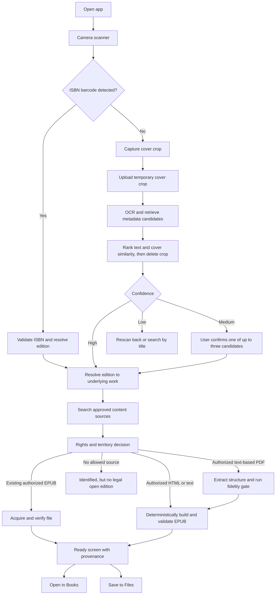

# Physical Book to EPUB — iOS Demo Product Plan

## 1. Purpose

This document defines a polished, rights-aware iPhone demo that turns a camera scan of a physical book into an authorized EPUB that the user can open in Apple Books or save to Files.

It describes what the product is, the end-to-end pipeline, the sources it trusts, the legal and privacy rules it enforces, the major user-interface states, the failure experience, and how the finished demo will be tested. It intentionally does not prescribe implementation code or settle pixel-level visual design; those decisions will be made during implementation and visual iteration.

The product is not a system for digitizing arbitrary copyrighted books. It is a discovery and delivery layer for public-domain and openly licensed digital editions that already exist, with a narrow deterministic conversion fallback for authorized HTML, structured text, and eligible text-based PDFs.

## 2. Product summary

The app's core promise is:

> Point your camera at a physical book. If a legal open edition exists, start reading it in seconds.

The demo should feel like a small piece of magic:

1. The app opens directly into a beautiful camera view.
2. The user frames either the front cover or the ISBN barcode on the back.
3. The app recognizes the book locally from a barcode or, for a front cover, through an ephemeral backend recognition request, then asks for confirmation when necessary.
4. It searches a controlled set of trustworthy legal sources.
5. It explains when the available digital edition differs from the scanned physical edition.
6. It obtains or creates a valid EPUB without altering the author's words.
7. The user chooses Apple Books or Files.

The app requires no account, login, subscription, personal library, social graph, or publisher relationship for the demo.

## 3. Product decisions locked for the demo

| Area | Decision |
|---|---|
| Platform | iPhone app built with Expo and React Native; no browser version |
| Development runtime | Expo Go for the initial functional phases; an Expo development build when custom native code or configuration is needed |
| Shipping runtime | A standalone signed iOS build; users never need Expo Go |
| Initial territory | United States only |
| Initial language | English-language recognition and books |
| Capture model | Hybrid: confidence-gated automatic capture plus a manual shutter |
| Scan targets | Front cover and EAN-13/ISBN barcode on the back |
| Authentication | None |
| Account or cloud library | None |
| Primary output | EPUB handed to Apple Books through the iOS share workflow |
| Secondary output | Save a copy to Files |
| Built-in reader | Not included in the first demo |
| Whole-book scanning/OCR | Explicitly excluded |
| PDF conversion | Rights-cleared, text-based PDFs only, gated by layout and fidelity checks |
| AI-generated rewriting | Explicitly prohibited |
| Backend | Small stateless open-source service for catalog resolution, rights decisions, conversion, and validation |
| Image privacy | Barcode data stays on-device; a front-cover crop is uploaded only for identification, processed ephemerally, excluded from logs, and deleted immediately afterward |
| Content scope | Public-domain and explicitly open-licensed files only |
| Distribution target | On-device demo/TestFlight first; App Store hardening later |

The U.S.-only boundary is important. Public-domain status differs by territory, and both Standard Ebooks and Project Gutenberg frame their copyright guidance primarily around the United States. A later global release would need a genuine territorial rights matrix rather than a translated disclaimer.

## 4. Product principles

### 4.1 The camera is the product

The user should not begin in a catalog, dashboard, or onboarding carousel. The first useful screen is the scanner. Supporting information stays behind subtle controls so the experience remains immediate.

### 4.2 Fast when confident, careful when uncertain

An ISBN barcode can identify a physical edition with high confidence. A front cover often identifies only the work, and decorative covers can produce imperfect OCR. The app should move automatically when evidence is strong and explicitly involve the user when it is not.

### 4.3 Work identity and edition identity are different

An ISBN identifies a particular edition and format. A freely available EPUB often represents a different edition of the same underlying work. The app must never imply that the downloaded EPUB is a digital replica of the physical printing unless the identifiers and rights evidence actually establish that.

### 4.4 Rights compliance is enforced, not disclaimed

A terms page is not the safety mechanism. The source allowlist, license rules, territorial restriction, provenance record, and conversion policy must prevent questionable files from being delivered. Legal copy in the interface explains the decision; it does not substitute for one.

### 4.5 Prefer an existing EPUB

The highest-quality and lowest-risk path is to deliver an authorized EPUB produced by a reputable source. EPUB generation is a fallback for clean authorized HTML, structured text, or a text-based PDF that passes strict extraction and layout checks; it is not the default.

### 4.6 No generative changes to book text

Machine learning may help identify a cover. It must not rewrite, summarize, modernize, correct, translate, or reconstruct the text placed inside the EPUB. Text transformation must be deterministic and auditable.

### 4.7 Failure is a designed outcome

Many modern books will have no legal free edition. “We identified the book, but could not find an authorized open edition” is a successful, honest product state—not a reason to search less trustworthy websites.

## 5. End-to-end product flow

### 5.1 First launch

The app shows one concise explanation before requesting camera access:

- Scan a cover or ISBN barcode.
- The camera is used only to identify the book.
- ISBN scans stay on the device. A cover crop is sent securely to the recognition service only when the user scans the front, then deleted after identification.

The system camera permission prompt follows. There is no multi-page onboarding. If permission is denied, the app offers two routes: open Settings or search manually by title and author.

### 5.2 Live scanner

The scanner is a dark, minimal full-screen camera experience with four adaptive corner guides rather than a rigid square. Books have varying aspect ratios, and the guides should communicate a target region without suggesting the cover must perfectly fill a fixed box.

The persistent instruction is short: “Scan a cover or ISBN.” A quieter secondary hint can state that the barcode is fastest.

The scanner watches for EAN-13 barcodes and keeps a cover shutter available. Its behavior is hybrid:

- A valid, stable ISBN barcode triggers automatic capture quickly.
- A front cover is captured with the shutter in the Expo Go build; a later native module may add confidence-gated automatic cover capture if it materially improves the experience.
- The shutter remains available at all times.
- The user can pinch to zoom and tap to focus.
- A brief visual freeze and subtle haptic confirm capture.

The app does not repeatedly buzz or flash while recognition fluctuates. Feedback is reserved for state changes: target found, capture completed, result ready, and recoverable error.

### 5.3 Processing transition

After capture, the camera image freezes and transitions into the recognition state rather than cutting to a generic spinner. The interface can reveal short truthful stages such as:

- Reading the cover
- Matching the book
- Checking open editions
- Verifying the EPUB

These are progress labels, not fake percentages. If the operation is long enough to be noticeable, the user can cancel and return to the camera.

### 5.4 Book confirmation

The app shows a confirmation sheet when the front-cover result is not unambiguous. It contains at most three candidates, each with:

- Cover thumbnail supplied by the metadata source
- Title and author
- Publication year or publisher when useful
- A short reason such as “Best cover match” or “Title and author match”

The user chooses a candidate or taps “None of these.” A valid barcode usually produces one candidate, but the recognized book is still shown briefly before acquisition so the user remains in control.

The confirmation asks whether this is the correct work, not whether it is the exact digital edition. That distinction avoids promising a replica of the scanned printing.

### 5.5 Digital-edition resolution

After the work is confirmed, the app searches approved content sources. If it finds an authorized digital edition that differs from the physical edition, the result screen states this plainly:

> A legal open edition of this work is available. Its cover, introduction, notes, formatting, or pagination may differ from your physical copy.

The result prioritizes clarity rather than legal density. A compact “Verified open edition” badge opens a details sheet containing the source, license, territory, retrieval time, and whether the app transformed the source.

### 5.6 Ready and export

The ready screen contains the digital edition's authorized cover, title, author, source, and two clear actions:

1. **Open in Books** — presents the iOS share workflow with a brief instruction to choose Books. Apple does not document a public API for silently inserting arbitrary local EPUBs into a user's Books library.
2. **Save to Files** — presents the iOS share workflow with a brief instruction to choose Save to Files and then a location.

The app retains the temporary EPUB long enough to complete either action, then removes it according to the cleanup policy. If the user cancels the share workflow, the ready screen remains available.

## 6. Recognition pipeline

### 6.1 Why an AI agent is not the primary recognizer

The most accurate design is a layered evidence system, not a single multimodal prompt. Barcode decoding, OCR, metadata search, and image similarity each provide independently verifiable evidence. A general AI model introduces cost, latency, privacy concerns, and the possibility of fabricated ISBNs.

The Expo app uses `expo-camera` for the live preview, photo capture, and ISBN barcode observations. Expo Camera is available in Expo Go, supports barcode detection, and uses Apple's modern scanner for its iOS scanning path. [Expo Camera](https://docs.expo.dev/versions/latest/sdk/camera/)

For the initial Expo Go demo, front-cover OCR and candidate-cover comparison run in the stateless backend. This keeps the first build testable without custom Swift modules while preserving a deterministic evidence pipeline. The backend receives only the cropped cover needed for recognition, does not persist it, and deletes it after producing candidates. If later profiling shows a meaningful privacy, latency, or offline benefit, an Expo development build can add a small native Apple Vision module without rewriting the React Native application. Expo describes a development build as a customizable version of Expo Go that can include arbitrary native libraries and configuration. [Expo development builds](https://docs.expo.dev/develop/development-builds/introduction/)

A multimodal model is not needed in the first demo. If added later, it may only propose search terms; its output must still be corroborated by a book metadata source before appearing as an identification.

### 6.2 Barcode path

The back-cover path is the strongest:

1. Detect an EAN-13 barcode.
2. Accept only book prefixes associated with ISBN-13.
3. Validate the ISBN checksum locally.
4. Require the same payload across stable observations before automatic capture.
5. Query both Google Books and Open Library by ISBN.
6. Reconcile their responses and resolve the edition to its underlying work.

ISBN identifies a particular edition and format, which is why it is valuable for metadata even when the final EPUB is a different edition. The [International ISBN Agency](https://www.isbn-international.org/content/what-isbn/10) explicitly describes the publication element as identifying a particular edition and format.

### 6.3 Front-cover path

The front-cover path works as follows:

1. Ask the user to place the cover inside the adaptive guide and use the manual shutter.
2. Preserve a clean camera boundary so a later Expo development build can add native book-boundary detection without changing the rest of the flow.
3. Capture a high-resolution image, crop it to the guide, compress it within a strict request limit, and upload it over HTTPS to the recognition endpoint.
4. Correct perspective and run accurate backend OCR with English-language correction.
5. Normalize punctuation, line breaks, diacritics, case, and common OCR spacing errors without rewriting words.
6. Extract likely title, subtitle, author, series, and publisher tokens from their relative position and size.
7. Query book metadata using several conservative title/author combinations.
8. Retrieve a small candidate set and their permitted cover thumbnails.
9. Rank candidates using text similarity, author agreement, cover-image similarity, language, and publication clues.
10. Delete the uploaded crop and intermediate image data whether recognition succeeds, fails, or times out.
11. Auto-select only when one candidate clearly outranks the others; otherwise ask the user.

Cover-image comparison happens only after OCR narrows the search. Attempting global visual search across millions of covers would require a large licensed cover index and is unnecessary for this demo.

### 6.4 Candidate evidence hierarchy

Evidence is ranked in this order:

1. Valid exact ISBN returned consistently by metadata services
2. Exact normalized title and author agreement
3. Strong title agreement plus strong cover-image similarity
4. Title, author, language, and publisher/year agreement
5. Partial OCR or visual similarity alone

The first tier can move directly to a single confirmation. Middle tiers show up to three choices. The final tier is not sufficient for identification; the app asks for the back barcode or manual title search.

Confidence thresholds will be calibrated from the recognition test corpus rather than chosen to make a staged demo look good. False automatic matches are more damaging than an extra confirmation tap.

### 6.5 Metadata sources

#### Google Books

Google Books supports title, author, publisher, ISBN, OCLC, and LCCN search fields and often supplies multiple identifiers and cover images. It is useful for edition discovery and for some public-domain files. API keys and usage terms are handled by the backend, and API content is not cached longer than permitted. [Google Books API usage](https://developers.google.com/books/docs/v1/using)

#### Open Library

Open Library is valuable for work/edition relationships, identifiers, and candidate covers. It is used as a low-volume discovery service, not as the app's unrestricted backend. The app identifies itself, caches permitted metadata, and respects the published rate limits. [Open Library API guidance](https://openlibrary.org/developers/api?show_page_status=1)

Open Library and Internet Archive availability flags are not treated as sufficient authorization to distribute a file.

## 7. Authorized content-source policy

The source resolver is an allowlisted adapter system. A generic web search is never used to find downloadable book files.

### 7.1 First-tier sources

| Source | Role in demo | Accepted content | Key conditions |
|---|---|---|---|
| Standard Ebooks | Preferred source for polished classics | Existing EPUB | U.S. public-domain scope; preserve its edition and provenance |
| Project Gutenberg | Broad public-domain fallback | Existing EPUB, or selected HTML/text for deterministic conversion | U.S. territory; use official catalog/feed and respectful direct-download behavior |
| Google Books | Metadata plus limited public-domain acquisition | EPUB, or eligible text-based PDF as a conversion source | Require `FULL_PUBLIC_DOMAIN`, country match, and an actual download link |
| OAPEN | Modern open-access scholarly books | Existing EPUB or eligible text-based PDF bitstream | Require an explicit acceptable license and matching record/file |
| DOAB | Discovery directory for open-access books | Publisher/OAPEN EPUB or eligible text-based PDF linked from a record | Re-check the item license and final content host; DOAB itself does not host the file |

Standard Ebooks is the preferred demo result because its files are carefully produced, accessible, and dedicated to the public domain in the United States. Its complete OPDS feeds have access conditions, including a path for qualifying open-source projects, so the demo initially uses a manually reviewed catalog and requests formal feed access if the project expands. [Standard Ebooks](https://standardebooks.org/), [feed access](https://standardebooks.org/collections/glad-books/feeds)

Project Gutenberg publishes OPDS and machine-readable catalogs, but its public site is not intended for aggressive automated traffic or high-volume proxying. The demo makes user-initiated, low-volume requests with an identifiable user agent and uses an approved download route or mirror. [Project Gutenberg catalogs](https://www.gutenberg.org/ebooks/offline_catalogs.html), [robot-access policy](https://www.gutenberg.org/policy/robot_access.html)

Google Books access information is territorial. The resolver must require a U.S. country result, `FULL_PUBLIC_DOMAIN`, and an actual download link. An EPUB can proceed directly to validation. A PDF-only result may enter the conditional PDF-conversion path, but only if the downloaded file is text-based and passes every rights, layout, and fidelity gate. A partial preview, browser-only view, purchase link, or sample does not qualify. [Google Books volume fields](https://developers.google.com/books/docs/v1/reference/volumes)

Google Books files are acquired only through the official user-initiated download link for that result. The demo does not mirror or permanently cache Google API content.

OAPEN exposes metadata and bitstreams through its REST API and accepts both PDF and EPUB deposits. The MVP prefers existing EPUB bitstreams and may convert an authorized text-based PDF when it passes the PDF eligibility gates. [OAPEN REST API](https://www.oapen.org/article/8185269-search-using-a-rest-api), [OAPEN file formats](https://www.oapen.org/publishers/11625552-upload-instructions)

DOAB records carry license information and download URLs but DOAB is a directory rather than a content host. The app must validate the license and destination for every result. [DOAB FAQ](https://doabooks.org/en/researchers/full-faq)

### 7.2 Sources reserved for later evaluation

- **Wikisource WS Export:** technically provides EPUB export, but the relationship among site licensing, transcription rights, underlying work status, and territory needs a separate policy.
- **Pressbooks Directory:** contains valuable open educational resources and EPUB exports, but books span the full license spectrum and are hosted across many independent networks.
- **SciELO Books:** offers OPDS and EPUB/PDF, but much of the catalog uses noncommercial licenses and requires territory/language expansion.
- **OpenStax:** currently emphasizes web, PDF, and DOCX rather than EPUB, and its 2026 licensing transition to CC BY-NC-SA complicates future monetization.
- **Internet Archive/Open Library files:** may be considered only if an individual item has explicit, independently verifiable public-domain or open-license evidence. Lending or “full text” availability is not enough.

### 7.3 Permanently excluded sources

- Shadow libraries, piracy indexes, torrents, and unofficial mirrors
- Search-engine results for arbitrary `.epub` or `.pdf` files
- Files whose host, provenance, or license cannot be verified
- DRM-protected, borrowed, or account-entitled files
- Retail samples and preview-only content
- A user's physical book pages as a source for whole-book OCR
- An AI model's assertion that a book is public domain

## 8. Rights decision engine

### 8.1 The engine decides, the UI explains

Every content candidate passes through a deterministic rights decision before acquisition. The decision produces one of four outcomes:

1. **Deliver exact EPUB** — an existing EPUB is explicitly permitted.
2. **Generate EPUB** — authorized HTML, structured text, or an eligible text-based PDF may be transformed and redistributed.
3. **Open at source only** — the item is free to read but redistribution or transformation is not established.
4. **Reject** — the license, territory, source, or file is unacceptable.

Only the first two outcomes can produce the Apple Books/Files result screen.

### 8.2 License policy for the initial demo

| Rights evidence | Existing EPUB | Generate a new EPUB |
|---|---:|---:|
| U.S. public domain / CC0 | Allow | Allow |
| CC BY | Allow with attribution | Allow with attribution and modification notice |
| CC BY-SA | Allow with attribution | Allow only when the generated edition preserves ShareAlike obligations |
| CC BY-NC or BY-NC-SA | Exclude from initial demo | Exclude from initial demo |
| CC BY-ND or BY-NC-ND | Exclude from initial demo | Exclude from initial demo |
| Free-to-read without a reuse license | Do not deliver | Do not generate |
| All rights reserved, unknown, borrowed, sampled, or DRM-protected | Reject | Reject |

Creative Commons explains that licenses permit use in any format, but attribution, NonCommercial, NoDerivatives, and ShareAlike conditions still matter. The first demo deliberately accepts a smaller set than may be legally possible so its behavior is understandable and remains compatible with possible future commercialization. [Creative Commons FAQ](https://creativecommons.org/faq/)

### 8.3 No independent copyright calculator

The app does not decide that a work is public domain merely because of author death date or publication year. Copyright rules include restorations, translations, editions, illustrations, and territory-specific exceptions. The demo relies on reviewed sources that make a clear rights representation, records that representation, and limits availability to the matching territory.

### 8.4 Physical edition versus open edition

The scanned cover can itself be copyrighted, as can a modern introduction, translation, annotations, typesetting, or illustrations. Therefore:

- The captured physical cover is used only for local identification and confirmation.
- It is never embedded into a generated EPUB.
- The output uses the authorized source EPUB's cover or a simple original typographic cover when generation is permitted.
- The result identifies the downloaded source edition separately from the physical scan.
- The app never claims that physical ownership grants a digital-copy entitlement.

Ownership of a material copy does not itself transfer rights in the copyrighted work, as stated in 17 U.S.C. §202. [U.S. Copyright Office](https://www.copyright.gov/title17/92chap2.html)

### 8.5 Provenance record

Every delivered EPUB is accompanied internally by a provenance record containing:

- Identified work and, when known, scanned physical-edition identifiers
- Digital-edition title, author, language, and identifier
- Source organization and canonical item URL
- Direct acquisition URL or approved source reference
- License name, version, canonical license URL, and rights statement
- Territory for which the decision was made
- Retrieval timestamp
- Original file hash
- Whether the file was passed through unchanged or generated
- Converter version and transformation manifest when generated
- Final EPUB hash
- EPUBCheck version and validation result

The user sees the human-readable subset under “Why this edition is available.” The full record can be included beside a saved file or made exportable for audit/debugging.

## 9. EPUB acquisition and generation

### 9.1 Existing EPUB path

Existing authorized EPUBs are always preferred. The app or backend:

1. Fetches from the approved acquisition URL.
2. Enforces HTTPS, redirects only to permitted hosts, a strict size limit, and a timeout.
3. Confirms the response is an EPUB rather than an HTML error page.
4. Performs safe container inspection.
5. Checks expected metadata and source identifiers when available.
6. Records the file hash.
7. Runs EPUBCheck, rejects conformance errors, and records any non-blocking warnings for review.
8. Hands the unchanged source file to the device.

The app should not “clean up” or repackage a valid source EPUB merely to add branding. That creates needless transformation, risks breaking signatures or metadata, and obscures provenance.

### 9.2 Generated EPUB path

Generation is deliberately narrow. It is allowed only from reviewed HTML, XHTML, XML, plain text, or an eligible text-based PDF whose rights evidence permits redistribution and transformation.

**Current demo boundary:** the implemented structured-source converter accepts only a strict HTML subset and explicitly marked plain text. XML/XHTML declaration handling, eligible PDF conversion, and source-image reuse remain planned extensions; until each has dedicated structural and per-asset rights validation, the app refuses those inputs rather than silently flattening them.

The generation process may:

- Normalize character encoding and line endings
- Remove source boilerplate when the source's terms permit it
- Convert obvious headings into a navigable chapter structure
- Preserve emphasis, quotations, poetry indentation, images, and footnotes when structurally represented
- Add required metadata, navigation, accessibility information, source attribution, and license notice
- Add a simple original typographic cover when no reusable cover is available

It may not:

- Rewrite sentences
- Correct alleged factual or grammatical errors with AI
- Modernize spelling or punctuation
- Translate or abridge text
- Infer missing passages
- Convert image-only scans or complex PDFs that fail the PDF quality gates
- Include illustrations without separate rights evidence

Every generated file targets EPUB 3.3, includes a package document and navigation document, and passes EPUBCheck before release. EPUB 3.3 defines the container, package, spine, manifest, content, and navigation requirements; EPUBCheck is the official conformance checker maintained for W3C. [EPUB 3.3](https://www.w3.org/TR/epub-33/), [EPUBCheck](https://www.w3.org/publishing/epubcheck/)

### 9.3 Conditional PDF-to-EPUB path

PDF conversion is supported when the file contains a reliable text layer and a layout that can be reconstructed without inventing reading order. Rights approval happens before any conversion work; being downloadable as a PDF does not itself authorize transformation or redistribution.

The PDF first passes an eligibility analysis:

1. Confirm that the source, license, and U.S. territory permit the app to create and deliver the EPUB.
2. Download and inspect the PDF using the same safe-file rules applied to EPUB acquisition.
3. Determine whether it is born-digital or contains a high-quality extractable text layer.
4. Measure text extraction coverage, character quality, page consistency, and whether reading order can be determined reliably.
5. Classify the layout: simple single-column prose is favored; ambiguous columns, dense tables, mathematical notation, forms, marginalia, and image-led layouts fail the automatic gate.
6. Confirm that embedded images and fonts can either be reused legally or omitted without damaging the work.

An eligible PDF enters a deterministic conversion pipeline:

- Extract text blocks together with page position, font size, emphasis, and image references.
- Detect and remove repeated running headers, footers, and page numbers.
- Reconstruct paragraphs and undo line-end hyphenation only when the neighboring text provides clear evidence.
- Infer headings and chapter boundaries from repeated layout patterns.
- Preserve simple footnotes, captions, and images when their relationships are unambiguous and rights-cleared.
- Produce structured intermediate HTML rather than writing directly to an EPUB archive.
- Compare normalized extracted content with the intermediate HTML to detect missing, duplicated, reordered, or unexpectedly changed text.
- Generate the EPUB using the same metadata, attribution, navigation, accessibility, and cover rules as other generated editions.
- Run EPUBCheck and the final text-integrity checks before making the file available.

No generative model rewrites or fills in PDF content. If automatic extraction cannot establish trustworthy reading order or content completeness, the app stops with a specific message such as “We found an authorized PDF, but could not safely convert its layout into an EPUB.” It may offer the source page for transparency, but it does not export a damaged EPUB.

The fidelity gate is fail-closed: after normalizing whitespace and approved line-end dehyphenation, every body-text block from the eligible PDF must be accounted for exactly once in the expected reading order. Every removed block must be classified and recorded as a repeated header, footer, or page number. Any unexplained omission, duplication, or ordering ambiguity rejects the conversion.

Image-only or scanned PDFs still require whole-book OCR and are outside the first demo. They can be evaluated later as a separate rights-restricted feature with page-level confidence, human review, and much stronger fidelity testing.

## 10. System shape

### 10.1 iPhone app responsibilities

The Expo/React Native app owns:

- Camera permission and live scanner experience
- Barcode recognition and ISBN validation
- Cover framing, capture, cropping, request compression, and upload disclosure
- Confidence presentation and user confirmation
- Download progress and temporary-file management
- Provenance and rights explanation screens
- Apple Books share workflow and Files export
- Accessible feedback, animation, and recovery states
- A development-only deterministic scenario harness that reaches every important state without camera hardware

### 10.2 Stateless backend responsibilities

The small open-source backend owns:

- Protecting third-party API keys and identifying the project to source APIs
- Ephemeral front-cover OCR, perspective normalization, and candidate-cover comparison
- Normalizing Google Books and Open Library metadata
- Maintaining the manually reviewed demo catalog
- Mapping physical editions to underlying works
- Searching approved content-source adapters in priority order
- Applying territory and license rules
- Generating EPUBs only from approved structured sources
- Running EPUBCheck
- Returning a short-lived result and provenance record
- Enforcing request-size limits, source allowlists, timeouts, and abuse-rate limits without creating user accounts

It does not require accounts, profiles, personal libraries, or persistent scan history. ISBN requests contain only a validated identifier. Front-cover requests contain a bounded cover crop used only for recognition; image bodies and derived image features are excluded from logs and deleted after the request.

For a real-device demo, this service is deployed to a small HTTPS endpoint with a health check and a reproducible deployment, rather than depending on a developer laptop being reachable. A local deployment remains available for development and automated tests.

### 10.3 Expo application strategy

Expo Go is the initial development runtime because it provides the camera, networking, file, and sharing capabilities required for the functional demo while preserving a fast QR-code and Fast Refresh workflow. It is a development tool, not the distributed product.

The project moves to an Expo development build when it first needs custom native code, native configuration unavailable in Expo Go, stable simulator E2E binaries, or release-candidate behavior. The React Native screens, state model, backend contracts, and test fixtures remain the same. Only the runtime container changes. A final user installs the standalone app or TestFlight build and never needs Expo Go.

The downloaded EPUB is written to the app's temporary storage and handed to the native iOS action sheet through Expo Sharing. Expo Sharing supports local-file sharing on iOS and is included in Expo Go. [Expo Sharing](https://docs.expo.dev/versions/latest/sdk/sharing/)

### 10.4 Why the backend is justified for a demo

An entirely on-device app would expose API keys, make catalog/rate-limit behavior harder to control, require shipping Java-based EPUBCheck or replacing it with a weaker check, and make rights rules difficult to update. A stateless backend preserves the no-auth experience while making the legal and content pipeline inspectable and reliable.

The backend remains replaceable. Scanner, identification, rights decision, acquisition, and export communicate through explicit product-level states so the demo does not become a single opaque service call.

### 10.5 Open-source posture

The Expo/React Native application code, backend code, catalog schema, source adapters, rights rules, recognition pipeline, and EPUB-generation pipeline can all be published in the project repository. EPUBCheck is open source, and the EPUB format is an open W3C standard.

The complete runtime is not literally composed only of open-source software: an iOS app necessarily uses Apple's proprietary platform frameworks, and Google Books is an external public API rather than open-source software. The accurate claim is that the project itself is open source and uses open standards plus legal open-content sources—not that every platform dependency is open source.

## 11. User-interface states and behavior

### 11.1 Visual direction

The visual character should be cinematic, quiet, and editorial rather than looking like a utility barcode scanner. The camera remains dominant. A dark neutral base, restrained typography, one confidence/success accent, translucent material where appropriate, and generous negative space provide the modern feel.

The app should use a small number of purposeful animations:

- Corner guides subtly settle onto a detected book
- A soft focus pulse indicates that the target is being evaluated
- The captured cover freezes and transitions into the result card
- The candidate card can visually morph into the authorized digital-edition card
- A single success haptic accompanies a verified result
- Progress labels cross-fade rather than jump

Animations must never disguise waiting or create false certainty. Reduce Motion produces simpler fades with the same information.

### 11.2 Screen inventory

The first demo requires only these product surfaces:

1. Camera-permission introduction
2. Live scanner
3. Processing transition
4. Candidate confirmation sheet
5. Authorized-edition ready screen
6. Identified-but-unavailable screen
7. Recovery/error states
8. Source and rights detail sheet
9. Minimal About/Privacy/Legal screen

There is no tab bar, feed, recommendation screen, store, profile, or cloud library.

### 11.3 Legal messaging without clutter

Legal information appears in three layers:

1. **At a glance:** “Verified open edition” or “No authorized open edition found.”
2. **Contextual clarification:** a one-sentence notice when the output differs from the physical edition.
3. **Details:** source, license, territory, and provenance in a sheet, plus a fuller About/Legal page.

The app does not use a large acceptance checkbox before every download. It also avoids suggesting Apple endorses the app or the legal determination. Apple requires apps to have rights to their included or accessed content and to be permitted by third-party service terms. [App Review Guidelines 5.2](https://developer.apple.com/app-store/review/guidelines/)

### 11.4 Accessibility

The polished demo must include accessibility from the beginning:

- VoiceOver names and hints for the scan region and capture control
- An audible/VoiceOver announcement when a barcode or cover is detected
- Dynamic Type on non-camera screens
- Sufficient contrast over variable camera imagery
- Status communicated with text and shape, not color alone
- Reduce Motion support
- A manual shutter that does not require waiting for automatic detection
- A manual title/author fallback for users unable to position a physical book in camera
- Touch targets that remain comfortably usable over the live preview

Apple's guidance recommends clear status feedback through multiple modalities and concise, specific permission explanations. [Apple feedback guidance](https://developer.apple.com/design/human-interface-guidelines/feedback), [privacy guidance](https://developer.apple.com/design/human-interface-guidelines/privacy/)

## 12. Failure and recovery design

| Situation | User-facing outcome | Recovery |
|---|---|---|
| Camera permission denied | Explain that scanning is unavailable | Open Settings or search by title |
| Barcode is not a valid ISBN | Keep scanning without declaring a match | Reframe barcode or scan front |
| Cover has too little readable text | Explain that the cover is hard to identify | Scan back barcode or enter title |
| Glare, blur, or perspective prevents capture | Show a short framing hint | Move closer, tilt book, use shutter |
| Multiple plausible books | Present up to three candidates | Select one, rescan, or manual search |
| Metadata services disagree | Do not auto-confirm | Ask user and show identifying details |
| Book identified but no open edition exists | Honest unavailable state | Scan another book; optionally copy book details |
| Source has PDF only | Check its rights, text layer, reading order, and layout complexity | Convert when every gate passes; otherwise explain why safe EPUB conversion was unavailable |
| License is unclear or incompatible | Treat as unavailable | Show that the source could not be verified |
| Source is temporarily offline | Preserve book identification | Retry source check or return later |
| Download is not an EPUB | Reject the response | Try the next approved source |
| EPUB is malformed or unsafe | Do not export it | Try another approved edition |
| Network disappears mid-flow | Preserve captured metadata locally for the session | Retry without rescanning |
| Apple Books is not installed/available | Do not promise it | Save to Files or use another compatible app |
| User cancels the share workflow | Return to ready screen | Try either export action again |

No error path broadens the search to unapproved sources.

## 13. Privacy and security

### 13.1 Privacy posture

- No account or login
- No contact, photo-library, location, or tracking permission
- Camera permission requested only when the scanner is shown
- Barcode observations are validated locally and sent as ISBN text only
- Front-cover recognition uploads one bounded crop over HTTPS only after camera permission and clear in-app disclosure
- Uploaded cover crops and derived image features are held only for the active request, excluded from application logs and backups, and deleted on success, failure, cancellation, or timeout
- No advertising SDKs
- No behavioral analytics in the first demo
- Operational logs omit cover images and minimize or hash book-query data
- Temporary EPUBs expire after export or a short session timeout
- The privacy screen states exactly what leaves the device

### 13.2 File and network security

EPUB is a ZIP-based web-content container and must be handled as untrusted input even when the source is reputable. The pipeline protects against oversized downloads, decompression bombs, path traversal, symbolic links, unsafe XML processing, scripts, remote trackers, and misleading redirects.

The demo will:

- Use HTTPS only
- Follow redirects only within approved source rules
- Set download and expanded-size limits
- Sanitize filenames and generated markup
- Prevent archive entries from escaping the extraction directory
- Reject encrypted or DRM-protected EPUBs
- Avoid executing EPUB script content in the app
- Avoid fetching remote EPUB resources during validation unless explicitly allowed
- Pass only a local file URL to the system share/export workflow
- Keep source credentials and API keys on the backend

W3C's EPUB reading-system specification calls out scripting, malicious content, remote resources, links, ZIP/XML processing, and reading privacy as explicit risks. [EPUB Reading Systems 3.3 security and privacy](https://www.w3.org/TR/epub-rs-33/)

## 14. Demo catalog and reliability strategy

The first build should not claim universal coverage. It should combine live recognition with a deliberately reviewed catalog of approximately 25–50 demonstrable works.

The catalog should contain:

- Famous public-domain novels with many modern physical covers
- At least several books with reliable back-cover ISBN metadata
- A few OAPEN books with exact open-access EPUBs and ISBNs
- At least two rights-cleared, text-based PDFs selected to exercise the conditional conversion path
- Covers with ornate typography, minimal typography, subtitles, and author prominence
- Intentional negative examples: modern copyrighted books with no authorized open edition
- Ambiguous titles that require candidate selection

For each supported work, the catalog records known identifiers, canonical metadata, approved digital editions, rights evidence, source URLs, file hashes, and expected test outcomes.

For filming or live presentation, the demo uses real source adapters and rights decisions. Reliability comes from reviewed metadata and permitted caching of selected public-domain files, not from a hidden branch that returns a bundled EPUB regardless of the scan. Standard Ebooks/CC0 files are the best candidates for permitted demo caching; other providers remain direct-download unless their terms clearly allow mirroring.

Before a public App Store submission, the project should retain evidence that each service permits the specific API, cover-display, download, and caching behavior. Apple may request authorization for third-party content or services.

## 15. Test strategy

Testing must prove four independent claims:

1. The app identifies books accurately enough to feel trustworthy.
2. It never delivers a file without acceptable rights evidence.
3. Every delivered file is safe, valid, and usable in Apple Books/Files.
4. The user can complete or recover from every state without developer intervention.

Every implementation phase also has an interaction gate. After automated tests pass, the app is launched in iOS Simulator and exercised through Computer Use. The walkthrough covers the phase's primary flow, alternate states, cancellation, retry, offline behavior, long content, and visible regressions. Simulator evidence is recorded before the phase is accepted.

Because iOS Simulator has no camera hardware, development builds include a hidden fixture/scenario launcher that injects deterministic barcode, cover, candidate, source, conversion, and failure observations at the camera boundary. These observations then travel through the same production state, networking, confirmation, conversion, download, and export code. The harness is unavailable in release builds. [Expo iOS Simulator limitations](https://docs.expo.dev/workflow/ios-simulator/)

Camera accuracy, focus, torch, haptics, device heat, and real Apple Books behavior are deferred to a consolidated physical-iPhone acceptance pass performed by the user after the functional implementation is complete. A phase may therefore be functionally complete with camera hardware explicitly marked unverified; the final demo cannot be declared device-ready until that pass succeeds.

### 15.1 Recognition test corpus

Create a physical and photographic corpus for every curated demo book:

- Front cover straight-on
- Front cover at moderate perspective angles
- Back ISBN at several distances
- Warm indoor light, daylight, and lower light
- Glossy-cover glare
- Partial occlusion by a hand or sticker
- Busy background and plain background
- Worn or older cover
- Multiple editions of the same work
- Similar titles by different authors

The expected result is recorded as exact edition, underlying work, acceptable candidates, and expected open-edition outcome.

Recognition acceptance targets for the curated demo set:

- Valid ISBN scans resolve to the correct physical edition every time in normal lighting.
- Front-cover scans place the correct work first or in the confirmation choices in at least 95% of normal-light test captures.
- The app makes no confident automatic selection for a wrong work in the release corpus.
- A normal successful barcode path reaches the ready screen in a few seconds on a typical connection.
- The user can always force capture or choose manual search when automatic recognition cannot proceed.

### 15.2 Metadata and ranking tests

Use recorded responses and controlled fixtures to test:

- Exact ISBN agreement
- ISBN missing from one provider
- Provider disagreement on title, author, or year
- Multiple editions sharing a cover
- OCR line-order changes
- Diacritics, punctuation, subtitles, initials, and pseudonyms
- Missing cover thumbnails
- Duplicate candidates returned by multiple services
- Rate limiting and temporary provider failure

Ranking tests verify both the top candidate and whether the app should auto-confirm, ask the user, or refuse to guess.

### 15.3 Rights-policy tests

Every row in the license policy becomes an explicit test case. Tests cover:

- U.S. public-domain source accepted
- Public-domain claim for the wrong territory rejected
- CC0 accepted
- CC BY accepted with required attribution
- CC BY-SA accepted only with ShareAlike handling
- NC and ND content excluded by the conservative demo policy
- Free-to-read but unlicensed content rejected
- Preview, sample, loan, DRM, and purchase-only files rejected
- Open Library `has_fulltext` without separate rights evidence rejected
- Google Books partial or sample access rejected
- Google Books full-public-domain record without an EPUB link rejected for EPUB delivery
- OAPEN/DOAB record whose final file license does not match metadata rejected

No UI disclaimer can override a failing rights decision.

### 15.4 EPUB tests

For acquired EPUBs:

- Correct file type and non-HTML response
- Container safety and size limits
- EPUBCheck returns no conformance errors
- Required package/navigation presence
- Metadata plausibly matches the selected digital edition
- No DRM/encryption
- Successful open in Apple Books on a physical device
- Successful save and reopen from Files

For generated EPUBs:

- EPUBCheck returns no errors
- Title, author, language, source, license, and modified date are correct
- Table of contents reaches every chapter
- Reading order is correct
- Footnotes and internal links work when present
- Images include usable alternative text when included
- Text comparison confirms no unintended word changes
- Attribution and transformation notice are present
- The original and final hashes are recorded
- The file opens in Apple Books at small and large font settings
- Every PDF body-text block is accounted for exactly once in expected reading order, apart from recorded headers, footers, and page numbers
- PDF pages with repeated headers, footers, and page numbers do not leak those artifacts into chapter text
- A complex or image-only PDF fails closed rather than producing an EPUB

### 15.5 User-interface and accessibility tests

- Every state can be reached with deterministic test data
- Every phase receives a Computer Use walkthrough in iOS Simulator after automated tests pass
- Key paths have repeatable Maestro E2E coverage against an installable simulator build
- Screenshots are captured for important states and later used for visual-regression comparison
- Camera permission allowed, denied, restricted, and later restored
- Automatic capture does not trigger repeatedly
- Manual shutter is always operable
- Processing can be cancelled safely
- Candidate sheet supports long titles and large Dynamic Type
- VoiceOver announces detection, capture, candidates, success, and errors
- Reduce Motion removes geometry-heavy transitions
- Light/dark camera backgrounds do not obscure controls
- Offline and slow-network states remain understandable
- Share and Files cancellation return to a stable ready state

### 15.6 Required end-to-end scenarios

1. **Front-cover success:** scan a recognizable *Pride and Prejudice* cover, confirm the work, obtain a Standard Ebooks edition, open it in Books.
2. **Barcode success:** scan a modern physical edition of a public-domain classic, resolve its ISBN to the work, explain the different digital edition, save it to Files.
3. **Open-access EPUB success:** scan a reviewed OAPEN title with an authorized EPUB and display its license attribution.
4. **PDF conversion success:** scan a reviewed title whose only approved source is a simple text-based PDF, convert it, verify content fidelity, and open the resulting EPUB in Books.
5. **PDF conversion refusal:** find an authorized but complex or image-only PDF and prove the app explains why it cannot safely convert it.
6. **Ambiguous result:** scan a title shared by multiple works and select from candidates.
7. **No legal edition:** scan a current copyrighted bestseller, identify it correctly, and stop at the unavailable state.
8. **Difficult cover:** fail to read an ornate front cover, then recover by scanning the back barcode.
9. **Source outage:** identify the book, simulate the preferred source being unavailable, and either use the next approved source or show retry.
10. **Unsafe file:** simulate an invalid or oversized EPUB and prove it is never exported.
11. **No network:** capture successfully, preserve the observation, reconnect, and finish without rescanning.
12. **Books unavailable:** finish acquisition and save to Files instead.

### 15.7 Simulator, Computer Use, and device verification

During implementation, Simulator and Computer Use are the primary visual and behavioral acceptance environment. The matrix includes small and large simulated iPhones, supported iOS versions available locally, light and dark appearance, large text, VoiceOver-oriented labeling checks, Reduce Motion, slow/offline networking, and every deterministic scenario. Expo supports local and hosted Maestro flows against iOS Simulator builds, so critical journeys are both automated and manually inspected. [Expo Maestro E2E guide](https://docs.expo.dev/eas/workflows/examples/e2e-tests/)

After the functional and visual phases are complete, run a consolidated real-device matrix:

- The oldest supported iPhone/iOS combination capable of the selected Expo Camera workflow
- A common mid-generation iPhone
- A current-generation iPhone
- The oldest supported OS and the current public OS
- At least one device with a smaller display and one larger display

The release candidate is filmed only after the same build passes the complete golden scenario suite without developer menus, network interception, or manual data injection. Until the user completes this final device pass, reports must say that camera hardware and Apple Books acceptance remain pending.

## 16. Delivery phases

This section is the high-level product sequence. The phase-by-phase backend, Expo app, automated-test, Computer Use, exit-gate, and user-handoff checklist is maintained in [phases.md](./phases.md).

### Phase 1 — Prove the complete seam

Build one uncompromised path before broad coverage:

- Scan a valid ISBN
- Resolve the work
- Find one reviewed Standard Ebooks EPUB
- Apply a real rights decision
- Download it
- Open it in Apple Books and save it to Files

This phase establishes that all system boundaries work end to end.

### Phase 2 — Add front-cover recognition

- Hybrid automatic/manual capture
- Cover crop and ephemeral backend OCR
- Metadata candidate search
- Backend candidate-cover similarity
- Confidence states and confirmation sheet
- Rescan and manual-search recovery

### Phase 3 — Build the trustworthy source resolver

- Curated Standard Ebooks catalog
- Project Gutenberg adapter
- Google Books public-domain rules
- OAPEN and DOAB adapters for existing EPUBs and eligible text-based PDFs
- Unified work/edition/source result
- Provenance record and rights-detail sheet

### Phase 4 — Add deterministic EPUB generation

- Only approved structured sources
- Conditional extraction of rights-cleared text-based PDFs
- PDF layout classification and fail-closed quality gates
- Structured intermediate HTML and normalized text-fidelity comparison
- Source-specific cleanup recipes
- Original typographic cover when needed
- Attribution, license, navigation, and accessibility metadata
- EPUBCheck and text-integrity verification

Generation can be omitted from the first public video if it delays a reliable existing-EPUB experience. It is valuable, but it should not weaken the core demo.

### Phase 5 — Polish and harden

- Final animation and haptic language
- Expo Go-to-development-build migration if it has not already been required
- Deterministic Simulator scenario harness and Maestro golden flows
- Full failure-state copy
- Accessibility pass
- Privacy and legal details
- Performance profiling
- Physical-device recognition corpus
- App Store/TestFlight documentation and third-party authorization evidence

## 17. Demo completion criteria

The demo is complete when all of the following are true:

- It launches directly into an understandable scanner with no account requirement.
- Hybrid capture supports automatic valid-ISBN scanning and manual front-cover capture.
- The recognition test corpus meets the defined accuracy targets.
- The app distinguishes the scanned physical edition from the authorized digital edition.
- At least 25 reviewed works have reliable approved acquisition outcomes.
- Negative copyrighted examples stop cleanly without suggesting unauthorized alternatives.
- Every downloadable result has a provenance and rights record.
- Every delivered EPUB passes EPUBCheck without conformance errors; generated EPUBs also pass text-integrity verification.
- Every PDF-derived EPUB passes reading-order, completeness, and artifact checks; ineligible PDFs fail without export.
- Existing and generated EPUBs open successfully in Apple Books on real devices.
- Saving to Files works and preserves a usable filename and extension.
- Barcode scans do not upload images; front-cover crops are uploaded only for recognition and are never retained after the request.
- All critical errors have a user-controlled recovery path.
- VoiceOver, Dynamic Type, contrast, and Reduce Motion have been verified.
- The exact build intended for the demo passes the end-to-end golden scenarios.

## 18. Explicit non-goals

The first version will not:

- Promise a free ebook for every physical book
- Prove ownership of a physical copy
- Scan an entire book or perform page-by-page OCR
- Reconstruct an EPUB from an arbitrary, image-only, or structurally ambiguous PDF
- Search shadow libraries or arbitrary web results
- Bypass DRM, loans, subscriptions, previews, or paywalls
- Include publisher-discount or ebook-purchase bundling
- Provide recommendations, social features, or shelf inventory
- Synchronize a personal library
- Include a native EPUB reader
- Generate audiobooks
- Use AI to edit or recreate copyrighted text
- Support every country, language, or source at launch

## 19. Sensible extensions after the demo

If the core product proves compelling, the next expansions are:

1. Local recent-scan history, stored only on device
2. Additional territories backed by a real rights matrix
3. More languages and language-aware OCR/ranking
4. More reviewed open-access sources and direct publisher partnerships
5. A Readium-based native reader with search, highlights, TTS, and accessibility
6. Shelf or multi-book scanning for cataloging—not automatic ebook entitlement
7. Optional publisher-authorized discounted digital editions
8. A source-contributor system with reviewable adapters and rights tests
9. Accessibility-specific services such as integration with authorized accessible-book providers where eligibility rules are respected

These are separate product increments. None is needed to make the first demonstration feel complete.

## 20. Final product position

This should be presented as a polished open-culture utility, not a loophole for duplicating books:

> Scan the book in your hand. We identify it, find a verified public-domain or openly licensed digital edition, and make it ready for your reader.

The memorable part is not merely OCR or EPUB packaging. It is the seamless combination of physical-world recognition, honest work-versus-edition resolution, transparent rights provenance, and a one-flow handoff into the reading app the user already trusts.

This plan is product and engineering guidance, not legal advice. Before commercial distribution or expansion beyond the conservative U.S. demo, qualified counsel should review the source agreements, license policy, territorial behavior, patent landscape, marketing claims, and App Store submission materials.
